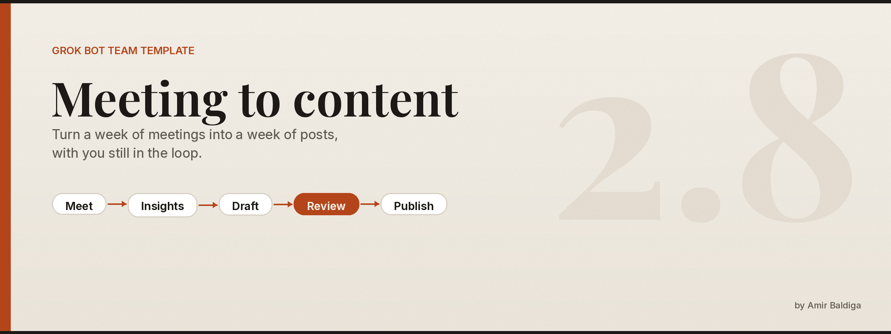
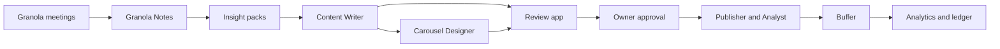
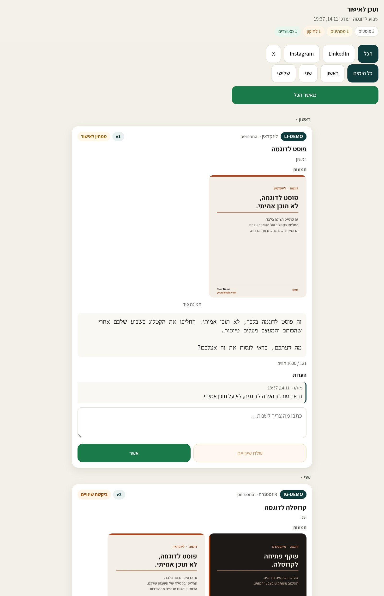
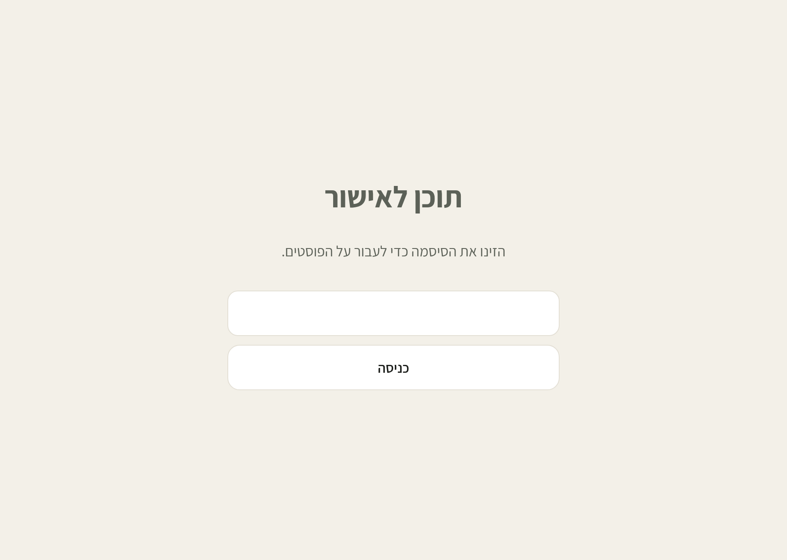
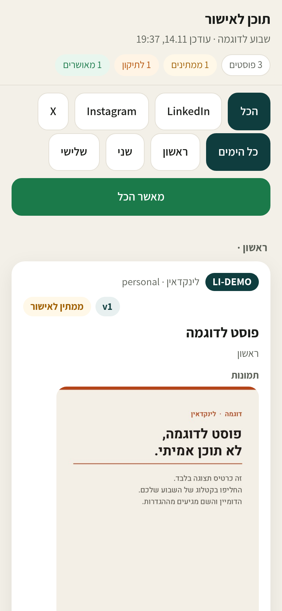

<div align="center">



<p>
  
  
  
  
  
  
</p>

# Meeting-to-content team

<strong>Turn a week of meetings into a week of posts, with you still in the loop.</strong>

<p>A plug-and-play Grok Bot team that reads Granola notes, drafts social copy, designs branded graphics, and waits for your approval in a private review app before anything is scheduled in Buffer.</p>

</div>

This repository is the shared kit: the review app, the company brain, the carousel renderer, and empty working folders. The bots live in your Grok Bot account. Import one template per role (links below), point them at a clone of this repo, and fill in your brand.

It does not include anyone's meetings, posts, photos, API keys, or analytics.

## How the team works



The Coordinator sits with you, assigns work, and enforces the standing rules. The longer map, privacy gates, and folder layout are in [docs/architecture.md](docs/architecture.md).

## The bots

| | Role | Connectors | Handoff |
|---|---|---|---|
| 🧭 | **[Coordinator](docs/bot-coordinator.md)** | Repo, review app, team group | Your brief becomes tasks for the rest of the team |
| 🎙️ | **[Granola Notes](docs/bot-granola-notes.md)** | Granola | Meetings become anonymized insight packs |
| ✍️ | **[Content Writer](docs/bot-content-writer.md)** | Repo, review app | Packs become channel-ready copy |
| 🎨 | **[Carousel Designer](docs/bot-carousel-designer.md)** | Repo, Cloudinary, review app | Copy becomes branded graphics |
| 📡 | **[Publisher and Analyst](docs/bot-publisher-and-analyst.md)** | Buffer, review app | Approved pieces are scheduled, logged, and measured |
| 🎬 | **[Reel Producer](docs/bot-reel-producer.md)** (optional) | Avatar or reel tool | A short video is attached for review, if you turn reels on |

Nothing is scheduled or published without your approval in the review app.

## The review app

A password-protected, mobile-first page. You see every post and every image, leave a comment, and tap approve or needs changes. The team reads that feedback with `sync.py` and comes back with a new version.

The shots below use obviously fake demo copy (`LI-DEMO`, `IG-DEMO`, `X-DEMO`). No real meetings or posts.

<div align="center">
  
  <p>
    
    &nbsp;
    
  </p>
</div>

Local setup and the Vercel deploy notes live in [review-app/README.md](review-app/README.md). The sample catalog ships with these three demo pieces so the page is not empty the first time you run it.

## Quick start in 15 minutes

1. **Clone this repo** and copy the config files (about 2 minutes):

   ```bash
   git clone <this-repo>
   cd meeting-to-content-team
   cp config/brand.example.json config/brand.json
   cp .env.example review-app/.env.local
   ```

2. **Fill in your brand** in `config/brand.json`: name, domain, colors, handles, and any blocked terms (about 3 minutes).

3. **Run the review app locally** (about 3 minutes). Put a local `ACCESS_KEY` and `TEAM_API_KEY` in `review-app/.env.local`, then:

   ```bash
   cd review-app
   python3 server.py
   ```

   Open `http://127.0.0.1:8787/?k=...` with the access key. You should see the three demo pieces. Never commit `.env.local`.

4. **Render a demo graphic** (about 4 minutes), after Chrome, Pillow and the Rubik or Heebo fonts are available:

   ```bash
   python3 carousel-kit/templates_kit/tk.py carousel-kit/templates_kit/specs/demo-week.json -o outputs/demo
   ```

   The footer will show the name and domain from `config/brand.json`.

5. **Create the bots** (about 3 minutes now, or later the same day): open each brief in `docs/`, create a Grok Bot, and paste the intro chat. Add them to one group. Where a role has a ready-made template, import it instead (see step 4 of the full setup).

That is enough to see the loop. Connecting Granola, Buffer, Cloudinary and Vercel is the next section.

## Full setup

<details>
<summary>Prerequisites</summary>

- A [Grok Bot](https://grok.com) account, so you can create the team
- [Granola](https://granola.ai), for meeting notes
- [Buffer](https://buffer.com), for scheduling (every channel you actually publish to)
- [Cloudinary](https://cloudinary.com), for public image URLs that Buffer can fetch
- [Vercel](https://vercel.com), to host the review app
- Optional: GitHub, to host this repo and to let each bot clone it
- Optional: an avatar or reel tool if you turn short video on later

Chrome, a Hebrew-capable font (Rubik or Heebo), Python 3 with Pillow, and ffmpeg are needed on the machine that renders graphics.

</details>

<details>
<summary>1. Brand, env, and goals</summary>

Copy and fill the private config files. They are gitignored.

```bash
cp config/brand.example.json config/brand.json
cp .env.example review-app/.env.local
```

In `config/brand.json` set your name, domain, colors, handles and any blocked terms. In `.env.local` set `TEAM_API_KEY` and a local `ACCESS_KEY`. Fill `brain/goals.md` with your targets, publishing windows and meeting-batch cadence.

Never commit real keys, tokens or passwords.

</details>

<details>
<summary>2. Deploy the review app to Vercel</summary>

Deploy from the `review-app/` folder. Set `TEAM_API_KEY`, `ACCESS_KEY_SHA256`, `SESSION_SECRET`, `BLOB_READ_WRITE_TOKEN`, `OWNER_ID`, `OWNER_LABEL` and `TIMEZONE`. Hash the review password with:

```bash
python3 -c "import hashlib,getpass; print(hashlib.sha256(getpass.getpass('Review password: ').encode()).hexdigest())"
```

Do not put the plaintext password in the repo or in a Vercel variable that gets logged. The app is marked `noindex`. Approval here is only your go-ahead for the Publisher bot to schedule later. More detail is in [review-app/README.md](review-app/README.md).

</details>

<details>
<summary>3. Connect Cloudinary and Buffer</summary>

Put Cloudinary credentials in the environment of the machine that runs `sync.py`. Put `BUFFER_ACCESS_TOKEN` in the Publisher bot's environment. Run:

```bash
python3 buffer_channels.py
```

Keep channel ids in a private config, not in this public repo.

</details>

<details>
<summary>4. Import each bot template</summary>

Import a role in one click where a template link is listed. For the roles still marked as coming soon, create a new Grok Bot and paste the matching brief, including the intro chat at the bottom of each doc.

| Role | Brief | Template link |
|---|---|---|
| Coordinator | [docs/bot-coordinator.md](docs/bot-coordinator.md) | Coming soon, use the brief |
| Granola Notes | [docs/bot-granola-notes.md](docs/bot-granola-notes.md) | [Import Granola Notes](https://x.ai/bot/jkk5T6jP1oRKH19EwJs6X) |
| Content Writer | [docs/bot-content-writer.md](docs/bot-content-writer.md) | [Import Content Writer](https://x.ai/bot/VG1kyN8AavH4tLo5YLMMy) |
| Carousel Designer | [docs/bot-carousel-designer.md](docs/bot-carousel-designer.md) | [Import Carousel Designer](https://x.ai/bot/WZk4OSUniSd-3ZAoMzWOq) |
| Publisher and Analyst | [docs/bot-publisher-and-analyst.md](docs/bot-publisher-and-analyst.md) | Coming soon, use the brief |
| Reel Producer (optional) | [docs/bot-reel-producer.md](docs/bot-reel-producer.md) | Coming soon, use the brief |

Add everyone to one group. In each intro chat, connect the connectors that role needs and point the bot at this repo.

</details>

<details>
<summary>5. First real week</summary>

Keep `weeks/`, `insight-packs/` and `ledger.csv` untracked (already in `.gitignore`) or work from a private fork.

Granola Notes writes an insight pack. Content Writer drafts. Carousel Designer renders. You approve in the review app. Publisher schedules. Every piece needs your approval, at least for the first month.

</details>

## Tools I use

Some of these are referral links, so signing up through them may support the author of this package. If you fork and share it, swap in your own links.

| Tool | What it is for | Link |
|---|---|---|
| Granola | Meeting notes that start the pipeline | [granola.ai](https://www.granola.ai) |
| Buffer | Scheduling to LinkedIn, Instagram and X | [buffer.com](https://buffer.com) |
| Cloudinary | Public image hosting for scheduled posts | [cloudinary.com](https://cloudinary.com) |
| Vercel | Hosting the private review app | [vercel.com](https://vercel.com) |
| APIhub (optional) | Short avatar reels, if you turn that on | [apihub.co.il](https://apihub.co.il/r/baldiga) |

## FAQ

<details>
<summary>Will my meetings or posts end up in a public repo?</summary>

No, not if you follow the default gitignore. Live weeks, insight packs, the ledger, approved examples, raw review feedback and `config/brand.json` stay untracked. This package ships empty skeletons and obviously fake demo copy only.

</details>

<details>
<summary>Is GitHub required?</summary>

No. GitHub is a convenient way to host the kit and let each bot clone it. A private folder on the machine the bots use is enough.

</details>

<details>
<summary>Do I need all six bots?</summary>

You need the Coordinator plus Granola Notes, Content Writer, Carousel Designer, and Publisher and Analyst for the full loop. Reel Producer is optional and can stay off.

</details>

<details>
<summary>Why is the review app in Hebrew?</summary>

The kit was built for a Hebrew-first workflow (RTL layout, Hebrew status labels). Copy can be in any language you write. The brand config, docs and this README are in English so the package is easy to fork.

</details>

<details>
<summary>Can I change the weekly recap format?</summary>

Yes. The default hook is "2.8 things I learned this week", with three real learnings. Edit `brain/formats/weekly-recap.md` to rename the series or change the cadence.

</details>

<details>
<summary>When can I publish without approving every piece?</summary>

The standing rule is that nothing goes out without your approval. After the first month you can relax that in `brain/goals.md` if the edit rate and privacy flags look good. Avatar reels and privacy calls should still need a yes from you.

</details>

<details>
<summary>Can I swap the tool links for my own?</summary>

Yes. Edit the Tools I use table (and the tool links in `docs/bot-*.md`) with your own referral links before you share your fork.

</details>

## Standing rules the team already knows

- A comment is given once and applies across platforms and future weeks.
- One central topic per week, per platform.
- Ideas, not people. Coaching and lecture content stays private.
- No em or en dashes. No links in the post body by default. The domain stays on images. Every post has a graphic.
- Nothing is scheduled or published without the owner's approval in the review app.

Read [brain/lessons.md](brain/lessons.md) and [brain/goals.md](brain/goals.md) before you change that list.

## Contributing

This is meant to be forked. If you send a change back:

- Keep secrets, live weeks, meeting content and personal photos out of the pull request.
- Keep the renderer and the review app configurable through `config/brand.json` and environment variables.
- Do not add real names, client details or blocked-term lists that belong to one person's practice.
- Run a secret scan (keys, tokens, emails, the usual) and `cd review-app && npm install && npm run build` before you open the PR.
- No em or en dashes in docs or in on-image copy.

Bug reports and template improvements are welcome. Please open an issue first for large changes.

## License

MIT. See [LICENSE](LICENSE).

<div align="center">

Built by Amir Baldiga · [gtmengineer.online](https://gtmengineer.online)

</div>
