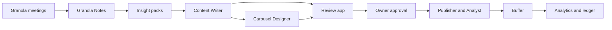

# Meeting-to-content team

A plug-and-play package for a small Grok Bot team that turns business meetings into a week of social content: insight packs, drafted posts, branded graphics, a private review app, Buffer scheduling, and a company brain that turns review comments into lasting rules.

This repository holds the shared code and the empty working folders. The bots themselves live in your Grok Bot account. Import one template per role (links below are placeholders until those templates are published), point them at a clone of this repo, and fill in your brand.

Built by Amir Baldiga · gtmengineer.online

## What you get

- A password-protected, mobile-first **review app** you can deploy on Vercel
- **Sync and brain tooling** so comments become lessons, and approvals become a gold-standard library
- A **carousel and template kit** for Hebrew RTL LinkedIn, Instagram and X graphics
- An empty **company brain**: standing rules, a goals template, a weekly recap format, and folders for approved examples and inspiration
- Role briefs so a Grok Bot user can recreate Granola Notes, Content Writer, Carousel Designer, Publisher and Analyst, the Coordinator, and an optional Reel Producer

It does not include anyone's meetings, posts, photos, API keys, or analytics.

## Team diagram



The Coordinator sits with the owner, assigns work, and enforces the standing rules. See [docs/architecture.md](docs/architecture.md) for the full pipeline, privacy gates and folder map.

## Prerequisites

- A [Grok Bot](https://grok.com) account, so you can create the team
- [Granola](https://granola.ai), for meeting notes
- [Buffer](https://buffer.com), for scheduling (every channel you actually publish to)
- [Cloudinary](https://cloudinary.com), for public image URLs that Buffer can fetch
- [Vercel](https://vercel.com), to host the review app
- Optional: GitHub, to host this repo and to let each bot clone it
- Optional: an avatar or reel tool if you turn short video on later

Chrome, the Rubik font, Python 3 with Pillow, and ffmpeg are needed on the machine that renders graphics.

## Setup

1. **Clone this repository** and create a private working copy for live weeks (or keep `weeks/`, `insight-packs/` and `ledger.csv` untracked, as `.gitignore` already does).
2. **Copy the config files** and fill them in:

   ```bash
   cp config/brand.example.json config/brand.json
   cp .env.example review-app/.env.local
   ```

   In `config/brand.json` set your name, domain, colors, handles and any blocked terms. In `.env.local` set `TEAM_API_KEY` and a local `ACCESS_KEY`. Never commit those files.

3. **Deploy the review app** to Vercel from `review-app/`. Set `TEAM_API_KEY`, `ACCESS_KEY_SHA256`, `SESSION_SECRET`, `BLOB_READ_WRITE_TOKEN`, `OWNER_ID`, `OWNER_LABEL` and `TIMEZONE`. Hash the review password with:

   ```bash
   python3 -c "import hashlib,getpass; print(hashlib.sha256(getpass.getpass('Review password: ').encode()).hexdigest())"
   ```

   Do not put the plaintext password in the repo or in a Vercel variable that gets logged. Details: [review-app/README.md](review-app/README.md).

4. **Connect Cloudinary and Buffer.** Put Cloudinary credentials in the environment of the machine that runs `sync.py`. Put `BUFFER_ACCESS_TOKEN` in the Publisher bot's environment. Run `python3 buffer_channels.py` once and keep channel ids in a private config, not in this repo.

5. **Fill `brain/goals.md`** with your targets, publishing windows and meeting-batch cadence.

6. **Import each bot template** into Grok Bot (placeholder links below). Add the bots to one group. In each intro chat, connect the connectors that role needs and point the bot at this repo.

7. **Do a dry run:** start the local review app, open the sample `LI-DEMO` piece, leave a comment, run `bash brain/review_loop.sh`, and render `carousel-kit/templates_kit/specs/demo-week.json`. Then delete the demo data before a real week.

8. **First real week:** Granola Notes writes an insight pack, Content Writer drafts, Carousel Designer renders, you approve in the review app, Publisher schedules. Every piece needs your approval, at least for the first month.

## Import each bot template

Replace these placeholders with the public Grok Bot template links when they are available.

| Role | Brief | Template link |
|---|---|---|
| Coordinator | [docs/bot-coordinator.md](docs/bot-coordinator.md) | `TEMPLATE_LINK_COORDINATOR` |
| Granola Notes | [docs/bot-granola-notes.md](docs/bot-granola-notes.md) | `TEMPLATE_LINK_GRANOLA_NOTES` |
| Content Writer | [docs/bot-content-writer.md](docs/bot-content-writer.md) | `TEMPLATE_LINK_CONTENT_WRITER` |
| Carousel Designer | [docs/bot-carousel-designer.md](docs/bot-carousel-designer.md) | `TEMPLATE_LINK_CAROUSEL_DESIGNER` |
| Publisher and Analyst | [docs/bot-publisher-and-analyst.md](docs/bot-publisher-and-analyst.md) | `TEMPLATE_LINK_PUBLISHER` |
| Reel Producer (optional) | [docs/bot-reel-producer.md](docs/bot-reel-producer.md) | `TEMPLATE_LINK_REEL_PRODUCER` |

Until a link exists, create a new Grok Bot and paste the matching brief, including the intro chat at the bottom of each doc.

## Tools I use

If you sign up through one of these links, it may support the author of this package. Replace the placeholders with your own affiliate URLs before you share the repo.

| Tool | What it is for | Link |
|---|---|---|
| Granola | Meeting notes that start the pipeline | `AFFILIATE_LINK_GRANOLA` |
| Buffer | Scheduling to LinkedIn, Instagram and X | `AFFILIATE_LINK_BUFFER` |
| Cloudinary | Public image hosting for scheduled posts | `AFFILIATE_LINK_CLOUDINARY` |
| Vercel | Hosting the private review app | `AFFILIATE_LINK_VERCEL` |
| APIhub (optional) | Short avatar reels, if you turn that on | `AFFILIATE_LINK_APIHUB` |

## Standing rules the team already knows

- A comment is given once and applies across platforms and future weeks.
- One central topic per week, per platform.
- Ideas, not people. Coaching and lecture content stays private.
- No em or en dashes. No links in the post body by default. The domain stays on images. Every post has a graphic.
- Nothing is scheduled or published without the owner's approval in the review app.

Read [brain/lessons.md](brain/lessons.md) and [brain/goals.md](brain/goals.md) before you change that list.

## License

MIT. See [LICENSE](LICENSE).
