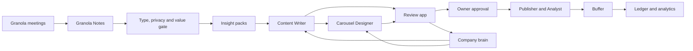

# Architecture

This repo is the code and the working files for a small Grok Bot team that turns business meetings into a week of social content. The bots themselves live in your Grok Bot account. This repository is what they share: brand config, the review app, the brain, the carousel kit, and the week folders.

## Pipeline

1. **Granola meetings** arrive through the Granola connector.
2. **Granola Notes** applies a type gate (drop coaching, lectures, medical or personal, interviews) and a privacy gate (ideas, not people). It scores the meeting 0-100. Meetings at 70+ can become a full week pack, 55-69 a mini pack, below that they wait in the idea bank. From a chosen cadence (every two days, or every 4-5 meetings, and only when at least 2 pass the bar) it writes an anonymized insight pack.
3. **Content Writer** reads the pack, `brain/lessons.md`, `brain/goals.md` and `brain/approved-examples/`, then drafts copy per channel. LinkedIn is usually first person. Each piece gets a `template: N` header. No links in the body unless the owner has asked for that.
4. **Carousel Designer** renders the graphic to that template with `carousel-kit/templates_kit`, uploads images (Cloudinary or local staging) and attaches them to the piece.
5. The **review app** is a password-protected, mobile-first page. The owner comments, approves, or asks for changes. The team talks to it with `review-app/sync.py`.
6. A review round starts with `bash brain/review_loop.sh`: pull comments into draft lessons, stop until each draft has a generalized rule, then revise siblings and future work. Approvals also flow into `brain/approved-examples/`.
7. After approval, **Publisher and Analyst** schedules via Buffer, logs the exact UTM URL in `ledger.csv`, and later pulls analytics for the weekly recap.
8. Nothing is scheduled or published without the owner's approval. For the first month, every piece should go through this loop.

## What lives where

| Path | Who uses it |
|---|---|
| `config/brand.json` | Everyone (name, domain, colors, handles, blocked terms) |
| `review-app/` | Owner (UI), the whole team (`sync.py`) |
| `brain/` | Every content task starts by reading `lessons.md` and goals |
| `carousel-kit/` | Carousel Designer |
| `templates/visual-formats-library.md` | Writer picks a number, Designer renders it |
| `insight-packs/` | Written by Granola Notes, read by Content Writer |
| `weeks/` | The live week plan, copy and renders |
| `idea-bank/` | Below-bar or cut pieces, for later |
| `ledger.csv` | Publisher and Analyst |
| `brain/formats/weekly-recap.md` | The Saturday (or chosen) recap format |

## Privacy and safety

- The review app is `noindex`, password-protected, and not a publishing surface.
- Secrets stay in environment variables or `.env.local`, never in git.
- Insight packs, week folders, the ledger and approved examples from real weeks stay out of a public clone. This package ships empty skeletons for those.
- Coaching and lecture content is private and never becomes a post.
